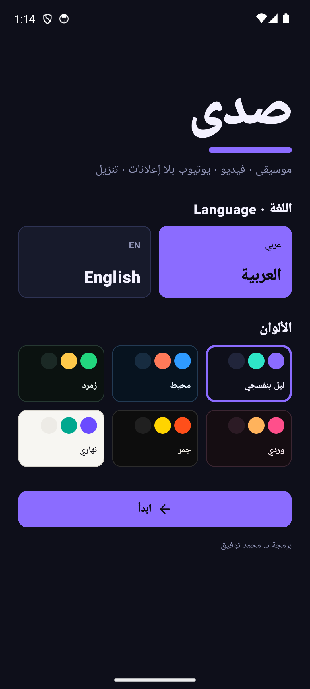
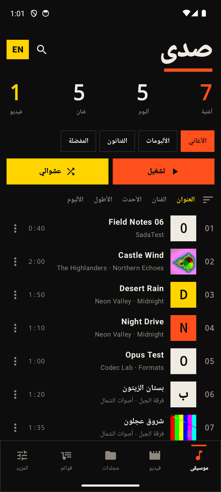
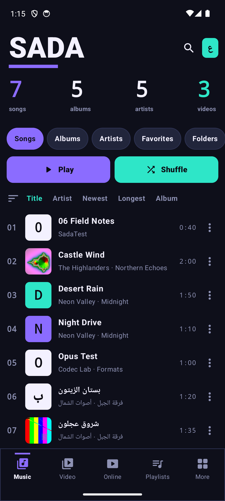
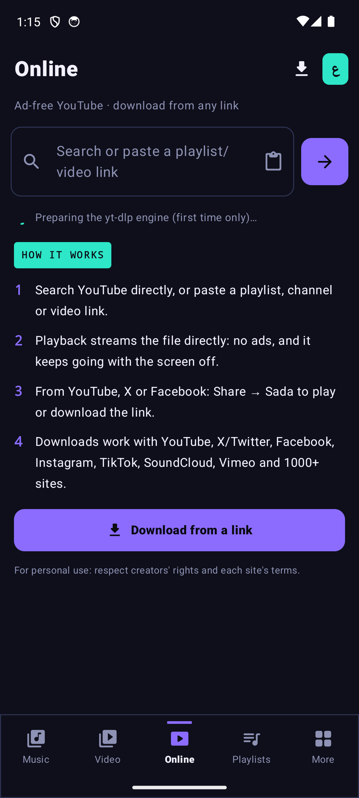
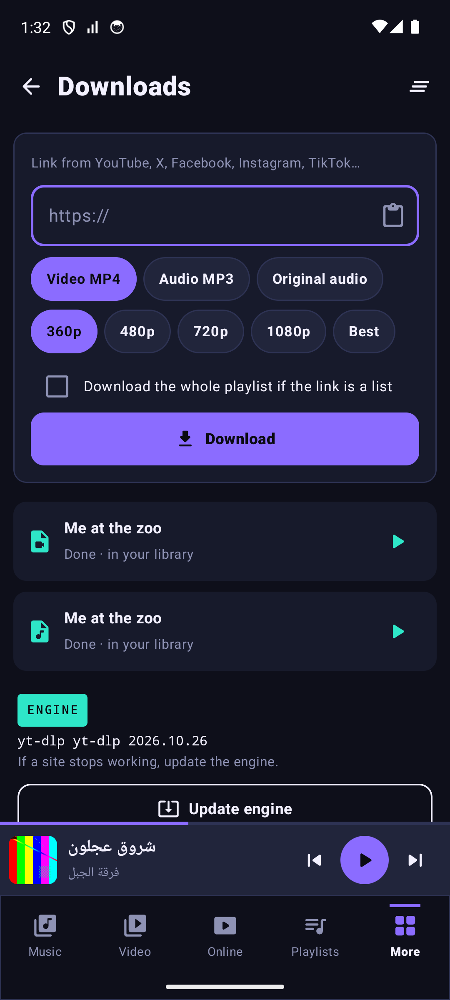

# صدى · Sada

**مشغّل موسيقى وفيديو أصلي لأندرويد — يوتيوب بلا إعلانات — تنزيل من أي رابط**
**Native Android music & video player — ad-free YouTube — download from any link**

Developed by **Dr. Mohammed Tawfik** (د. محمد توفيق), Department of Cyber Security, Faculty of IT, Ajloun National University · kmkhol01@gmail.com · ORCID [0009-0004-7622-5991](https://orcid.org/0009-0004-7622-5991)

<p>
    
</p>

## Download · التنزيل

Get the APK from [Releases](../../releases/latest):
- `Sada-1.0.0-arm64.apk` for almost every phone from the last 6+ years
- `Sada-1.0.0-armv7.apk` for older 32-bit phones

## الميزات

**موسيقى**
- مكتبة تلقائية: أغانٍ، ألبومات، فنانون، مجلدات، مفضلة، وقوائم ذكية (الأكثر تشغيلاً، شُغّلت مؤخراً، أضيفت حديثاً)
- قوائم تشغيل خاصة بك (إنشاء، إعادة تسمية، ترتيب، حذف) وطابور قابل للتعديل
- تشغيل في الخلفية مع إشعار وتحكم من شاشة القفل والسماعات
- معادل صوت (Equalizer) بأعمدة قابلة للسحب، وتعزيز الجهير، وصوت محيطي ثلاثي الأبعاد، ومضخّم صوت، وصدى القاعة
- مرئيات حيّة (FFT) وكلمات متزامنة ‎.lrc‎ مع الانتقال بلمس السطر
- السرعة والطبقة، مؤقت نوم مع خفوت تدريجي، تكرار مقطع A-B، تخطّي الصمت

**فيديو**
- إيماءات: السطوع (يسار)، الصوت (يمين)، التقديم (سحب أفقي)، نقرتان ±10 ث، تكبير بإصبعين
- ترجمات داخلية وخارجية (SRT/VTT/ASS) مع حجم ولون الخط، واختيار مسار الصوت
- صورة داخل صورة، تشغيل الفيديو كصوت في الخلفية، لقطة شاشة، قفل الشاشة، تدوير، استئناف من آخر موضع

**أونلاين**
- بحث يوتيوب وتشغيل القوائم والقنوات **بلا إعلانات** (صوت في الخلفية أو فيديو)
- تنزيل فيديو MP4 أو صوت MP3 من يوتيوب وX (تويتر) وفيسبوك وإنستغرام وتيك توك وساوند كلاود وأكثر من 1000 موقع
- من أي تطبيق: مشاركة ← صدى
- تحديث تلقائي لمحرك yt-dlp

**عام**: عربي/إنجليزي، ست لوحات ألوان (منها نهاري)، بلا إعلانات ولا تتبّع.

## Features

- **Music**: library (songs, albums, artists, folders, favourites, smart lists), playlists and editable queue, background playback with notification and lock-screen controls, 5-band equalizer plus bass boost, 3D surround, volume booster and reverb, live FFT visualizer, synced `.lrc` lyrics, speed and pitch, sleep timer with fade-out, A-B repeat, skip silence.
- **Video**: gestures for brightness, volume, seek, double-tap ±10 s and pinch zoom; embedded and external subtitles (SRT/VTT/ASS); audio track choice; picture-in-picture; background audio; snapshots; lock; rotation; resume.
- **Online**: YouTube search, playlists and channels with no ads, as background audio or as video. Download MP4 or MP3 from YouTube, X, Facebook, Instagram, TikTok, SoundCloud, Vimeo and 1000+ other sites. Share a link to Sada from any app. The yt-dlp engine updates itself.
- **Formats**: MP3, AAC, M4A, FLAC, ALAC, WAV, OGG, Opus, AC3/E-AC3, AMR · MP4, MKV, WebM, AVI, MOV, 3GP, TS, FLV · H.264, HEVC, VP9, AV1 · HLS, DASH, RTSP. ExoPlayer is used, with an FFmpeg audio fallback.
- **General**: Arabic and English interface, six colour themes, no ads, no tracking.

## Build

```bash
cd android
./gradlew assembleRelease
```

Requirements: JDK 17 or newer (Android Studio JBR) and Android SDK 36.

**Stack**: Kotlin 2.4, Jetpack Compose, AndroidX Media3 1.9 (ExoPlayer, MediaSession, HLS, DASH), Jellyfin `media3-ffmpeg-decoder`, `youtubedl-android` (yt-dlp, Python and FFmpeg).

## Note

Online features are for personal use. Respect creators' rights and each site's terms of service.

## License

MIT for this source code. Third-party libraries keep their own licenses: youtubedl-android and yt-dlp are GPL-3.0 and Unlicense; Media3 is Apache-2.0; FFmpeg is LGPL/GPL.
